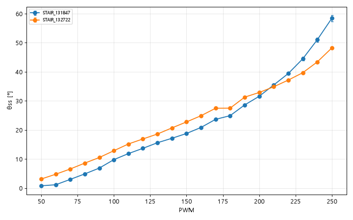

# 2026-11-13 run1 — 기구 수정 후 개루프 재식별

**기구 수정**(케이블 간섭 최소화) 뒤 처음 얻은 개루프 데이터입니다. 케이블 간섭은 아직 꽤 남아 있다고 합니다(사용자 설명). 이 run의 모델이 이후 모든 설계와 시뮬레이터(`analysis/pid_design.py`, `lab/sim.js`)의 기준이 됩니다. 폐루프 검증은 [run3 보고서](../../20261113_run3/analysis/REPORT.md)에 있습니다.

| 파일 | 시험 | 조건 |
|---|---|---|
| STAIR_131847 | 정적 특성 | PWM 50→250, 10씩, 계단 **8 s** (β 0.006, DLPF 4) |
| STAIR_132722 | 정적 특성 | PWM 50→250, 10씩, 계단 **6 s** (β 0.011, DLPF 5) |
| STEP_133052, STEP_133130 | 스텝 ×2 | PWM 160→172→160, pre 12 s / 10 s / 10 s |
| CHIRP_133220, CHIRP_133338 | 스윕 사인 ×2 | PWM 160 ± 12, **0.1→8 Hz** 로그, 60 s |

공통: 펌웨어 2.0, **축 Z+**(11-06은 Z−), STEP·CHIRP는 β 0.004, DLPF 5(10 Hz), ±16 g / ±2000 °/s, Ts = 10 ms, 샘플 누락 없음. 모터 전원 전압은 기록되지 않았습니다.

재현:
```
python analysis/aero_analyze.py data/20261113_run1
python analysis/aero_model_fit.py --est "data/20261113_run1/aero_CHIRP_*.csv" --val "data/20261113_run1/aero_CHIRP_*.csv" "data/20261113_run1/aero_STEP_*.csv"
python analysis/aero_model_fit.py --est "data/20261113_run1/aero_CHIRP_*.csv" --val "data/20261113_run1/aero_CHIRP_*.csv" "data/20261113_run1/aero_STEP_*.csv" --model 0.14 0.319 0.021 2.84 0.136 0.05 6
python analysis/aero_closedloop.py data/20261113_run3 --model 0.14 0.319 0.021 2.84 0.136 0.05 6 --margin-k 0.12 0.14 0.24      # 느린 경로(Ks, Tc)를 정한 폐루프 비교 (11-15 뒤 기본 모델이 바뀌어 --model 필요)
```
그림: `static_map.png`, `dynamic_fit.png`(2차 모델 OE 맞춤, 참고용), `ringing.png`, `model_fit.png`(주파수응답 맞춤), `model_check.png`(**최종 모델** 주파수응답 + 시간영역)

## 1. 품질: 11-06보다 훨씬 깨끗함

| 지표 | 11-06 run3 (±25) | **11-13 run1** (STEP·CHIRP) |
|---|---|---|
| θ<sub>acc</sub> σ (진동) | 17–19° | **3.3–4.7°** (STAIR는 고 PWM까지 가서 13–19°) |
| 자이로 진동 σ | 25–27 °/s | **6–7 °/s** |
| max \|∫ω − θ\| | 1.5–5.9° | 1.0–6.2° (STAIR 16°: 2–3분 기록의 자이로 바이어스 적분, 분석은 Madgwick θ 사용) |
| 최대 \|ω\| (포화 ±2000 °/s) | — | 56 °/s 이하, 포화 없음 |
| 반복 쌍 상관 | 0.976 | CHIRP 0.914, STEP **0.977** |
| 단일 기록 SNR | 25 | CHIRP 10.3, STEP **32** |
| 잡음 한계 적합도 | ≈80% | CHIRP **≈70%**, STEP **≈83%** |

- 진동 지표가 4–5배 줄었습니다. DLPF 5(10 Hz)와 기구 수정 둘 다 기여했을 것으로 보입니다(따로 분리하지 않음).
- 펌웨어의 게이트·포화 카운터는 `S` 줄에만 있고 CSV에 저장되지 않아 확인하지 못했습니다. 각속도 최대값으로 보면 자이로 포화는 없습니다.
- CHIRP의 SNR이 11-06 ±25 기록보다 낮은 것은 진폭이 ±12이고 60 s를 8 Hz까지 나눠 써서 응답이 작은 고주파 구간이 길기 때문입니다. 그래도 반복 두 기록의 주파수응답 차이는 대부분 2–10%입니다.

## 2. 정적 특성 (STAIR)



| PWM | 50 | 100 | 140 | 160 | 180 | 200 | 220 | 250 |
|---|---|---|---|---|---|---|---|---|
| STAIR_131847 (8 s) | 0.8° | 9.8° | 17.1° | 20.9° | 24.9° | 31.6° | 39.4° | 58.4° |
| STAIR_132722 (6 s) | 3.1° | 12.9° | 20.7° | 24.9° | 27.5° | 32.9° | 37.2° | 48.2° |
| 11-06 run2 평균 (기구 수정 전) | 5.4° | 12.0° | 19.6° | 23.5° | 26.9° | 30.3° | 33.2° | 40.0° |

- 기울기: PWM 130–170에서 **0.20–0.22 °/PWM**, 160–200에서 0.20–0.26. 11-06(0.19–0.21)과 운전점 근처는 비슷하지만, **PWM 200 이상에서 훨씬 가팔라졌습니다**(250에서 48–58°, 수정 전 40°).
- 두 계단 기록이 PWM 50–200에서 평균 **3.2°**(RMS 3.3°) 차이 나고, 고 PWM에서는 반대로 10°까지 벌어집니다. 피벗 마찰·케이블에 의한 히스테리시스와 아래의 느린 크리프(계단 6 s와 8 s의 정착 정도가 다름) 때문으로 보입니다.
- 폐루프 평형점(run2·run3, θ를 PID로 유지할 때의 PWM)은 20° ↔ PWM 129–145, 25° ↔ 155–163, 30° ↔ 193–201로 두 계단 사이에 들어갑니다. `lab/sim.js`의 정적 지도는 두 계단의 평균을 썼습니다(180의 꺾임만 보정).

## 3. 주파수응답과 전달함수 (CHIRP 0.1–8 Hz)

CHIRP 범위가 8 Hz까지라 **공진을 충분히 덮습니다.** 6 Hz 이상은 응답이 0.003 °/PWM 이하라 잡음 수준이지만, 공진(2.8 Hz)과 그 뒤 −40 dB/dec 감쇠는 분명합니다.

| f [Hz] | 0.10 | 0.29 | 0.53 | 0.99 | 1.58 | 2.15 | 2.51 | **2.93** | 3.42 | 3.99 | 5.43 |
|---|---|---|---|---|---|---|---|---|---|---|---|
| \|G\| 133220 | 0.121 | 0.137 | 0.095 | 0.070 | 0.061 | 0.069 | 0.084 | **0.084** | 0.039 | 0.018 | 0.005 |
| \|G\| 133338 | 0.121 | 0.117 | 0.091 | 0.071 | 0.059 | 0.067 | 0.089 | **0.083** | 0.038 | 0.018 | 0.005 |
| 위상 (평균) | −10° | −38° | −53° | −78° | −99° | −122° | −147° | **−205°** | −252° | −268° | −297° |
| 맞춤 모델 \|G\| (느린 경로 없음) | 0.136 | 0.121 | 0.098 | 0.070 | 0.059 | 0.065 | 0.082 | 0.081 | 0.037 | 0.017 | 0.005 |

**최종 모델** (주파수응답 맞춤 + 폐루프 기록으로 느린 경로 결정, [run3](../../20261113_run3/analysis/REPORT.md) §3):

```
G(s) = [ K/(0.319 s + 1) · 17.8²/(s² + 4.85 s + 17.8²)  +  Ks/(6 s + 1) ] · e^(−0.021 s)      [deg/PWM]
       K = 0.14 (빠른 경로, 0.12–0.24),  Ks = 0.05 (느린 경로),  정적 이득 K + Ks ≈ 0.19
       공진 fr = 2.84 Hz (ωr = 17.8 rad/s), ζr = 0.136,  T = 0.319 s,  지연 L = 21 ms
MATLAB:  s = tf('s'); wr = 2*pi*2.84;
         G = (K/(0.319*s+1)*wr^2/(s^2+2*0.136*wr*s+wr^2) + 0.05/(6*s+1)) * exp(-0.021*s);
```

| 항목 | 11-06 (기구 수정 전) | **11-13 (수정 후)** | 비고 |
|---|---|---|---|
| 빠른 경로 이득 K | 0.12–0.21 (세션 중 감소) | **0.14** (CHIRP 0.13–0.145, 20° 릴레이 0.15, 30° 릴레이 0.24) | 운전점이 높으면 커짐 |
| 시정수 T | 0.328 s | **0.319 s** | 같음 |
| 지연 L | 16 ms | **21 ms** | DLPF 4(21 Hz) → 5(10 Hz)로 바꾼 만큼(약 +6 ms) |
| 구조 공진 | 3.47 Hz, ζ 0.123 | **2.84 Hz, ζ 0.136** | **약 18% 낮아짐** |
| 위상 −180° 교차 | 3.38 Hz | **2.77 Hz** (\|G\| = 0.092 → 순수 P 한계 ≈ 11 PWM/°) | |
| 느린 경로 | 없음 (스텝 > 스윕 이득 차이만 관찰) | **Ks 0.05, Tc 6 s** | 새로 모델링 |
| 정적 기울기 (PWM 140–160) | 0.19–0.21 | 0.20–0.22 | |
| 공진 피크 / 1차 모델 | 약 3배 | 약 3.5배 (1/2ζ = 3.7) | 비슷함 |

- **공진이 3.47 → 2.84 Hz로 내려갔습니다.** 기구 수정으로 막대·마운트의 강성이나 질량 분포가 바뀐 것으로 보입니다. 11-06 모델(공진 3.47 Hz)을 이 데이터에 대 보면 주파수응답 오차가 **55–59%**이고(새 모델은 9%), CHIRP 시간영역 적합도는 62–63%입니다(새 모델 71–73%).
- **3.47 Hz 노치는 이제 맞지 않습니다.** 사용자도 run2에서 노치를 2.85 Hz로 옮겨 썼습니다(`notch_cHz=285`).
- 느린 경로를 넣지 않고 주파수응답만 맞추면 K = 0.138, T = 0.319, L = 21 ms, 2.84 Hz, ζ 0.136입니다(`model_fit.txt`). 느린 경로(Ks 0.05, Tc 6 s)를 고정하고 다시 맞춰도 K 0.131, T 0.30 s, L 22 ms, 2.86 Hz, ζ 0.140으로 빠른 경로의 모양은 거의 같습니다.

### 느린 경로 (Ks/(6 s + 1))가 필요한 이유

- **스텝과 스윕의 이득 차이**: CHIRP에 맞춘 K는 0.13–0.145인데, 같은 시각(3분 안)의 스텝은 Δθ/ΔPWM = 2.06/12 = **0.17–0.18**, 계단 기울기는 0.20–0.22입니다. 11-06에도 같은 현상(스텝 0.19–0.21 vs 스윕 0.155)이 있었는데, 그때는 시간에 따른 이득 감소와 섞여 원인을 정하지 못했습니다. 이번에는 3분 안이라 시간 변화로 설명되지 않습니다.
- **스텝 응답 모양**: 빠르게 약 0.14 × 12로 올라간 뒤, 몇 초에 걸쳐 0.3–0.5° 더 올라갑니다. 내려갈 때도 수 초에 걸친 꼬리가 남습니다(`model_check.png` 아래).
- **폐루프에서 결정적**: 기준을 일정하게 유지하는 동안 PWM이 6 s에 10–15만큼 계속 줄고, 기준을 내린 뒤에는 PWM이 아래로 내려갔다가 다시 올라옵니다(run3 `closedloop_fit.png`). 빠른 경로만 있는 모델로는 PWM 적합도가 74–79%에 그치고, 느린 경로를 넣으면 **93–95%**가 됩니다.
- 물리적 원인은 확정하지 못했습니다. 케이블의 점탄성(천천히 펴지거나 꼬이는 힘)이나 피벗 마찰의 크리프로 추정합니다. 수 초 단위라 제어 대역(0.3–1 Hz)보다 훨씬 느려 안정성에는 영향이 거의 없고, 적분 동작과 PWM 궤적에만 영향을 줍니다.
- 0.1 Hz에서 최종 모델 이득(0.144)이 측정(0.12)보다 약 20% 큽니다. 느린 경로가 저주파 스윕에서는 실제보다 조금 크게 나타납니다(소진폭 양방향 운동에서는 마찰로 덜 움직이는 것으로 추정).

시간영역 검증 (`model_check.txt`, 가진 구간 평균 제거):

| 기록 | 최종 모델 | 느린 경로 없는 맞춤 | 11-06 모델 (K=0.14) | 잡음 한계 |
|---|---|---|---|---|
| CHIRP_133220 | **72.6%** | 71.0% | 63.0% | ≈70% |
| CHIRP_133338 | **71.5%** | 74.5% | 62.2% | ≈70% |
| STEP_133052 | **64.7%** | 38.2% | 39.4% | ≈83% |
| STEP_133130 | **80.7%** | 55.2% | 56.5% | ≈83% |

- 최종 모델은 CHIRP 두 기록에서 잡음 한계에 도달하고, STEP에서는 81%(한계 83%)와 65%입니다. STEP_133052는 스텝 직후 약 0.4°의 언덕이 있었는데, 같은 입력의 다른 기록에는 없어 마찰·케이블에 의한 비재현 성분으로 봅니다.

## 4. 자유 진동 (계단 링잉)

`ringing.png`: 적합 기준을 통과한 계단은 PWM 50→60 하나뿐입니다(0.52 Hz, ζ 0.57). 정착 각도가 작은 곳이라 대표성이 없습니다. 진자 모드는 11-06처럼 **과감쇠**이고, 진동처럼 보이는 것은 2.84 Hz 구조 공진입니다.

## 5. 결론

- 수정된 기구의 모델: 빠른 경로 **1차 T 0.32 s + 공진 2.84 Hz/ζ 0.14 + 지연 21 ms**, 빠른 이득 **K ≈ 0.14**(운전점에 따라 0.12–0.24), **느린 경로 Ks 0.05/Tc 6 s**.
- 11-06과 비교해 **공진 주파수가 18% 낮아진 것**이 제어에 가장 중요한 변화입니다. 노치 주파수와 Z-N의 Tu가 함께 바뀝니다(Tu 0.30 → 0.37 s).
- 이 모델이 폐루프 실측과 맞는지는 [run3](../../20261113_run3/analysis/REPORT.md)에서 확인했습니다(θ 적합 84–94%, 20° 릴레이 Tu·Ku 오차 2% 이내).

## 6. 다음 실험 권장

1. **모터 전원 전압 기록** (여전히 없음). 30°에서 이득이 커지는 것이 운전점 때문인지 시간 때문인지 가르려면 필요합니다.
2. 운전점별 소신호 이득: 20°, 25°, 30°에서 각각 CHIRP(±25, 0.1–5 Hz) 또는 릴레이를 연달아 하면 K(θ)를 직접 얻습니다. RL 도메인 랜덤화 범위를 좁힐 수 있습니다.
3. 느린 경로 확인: 30 s 이상 유지하는 긴 스텝(위·아래) 2회. Tc와 Ks, 그리고 방향에 따른 차이(히스테리시스)를 분리할 수 있습니다.
4. 계단 시험은 같은 조건(계단 시간·β·DLPF)으로 두 번 하세요. 이번에는 두 기록의 조건이 달라 자동 재현성 계산이 빠졌습니다.
