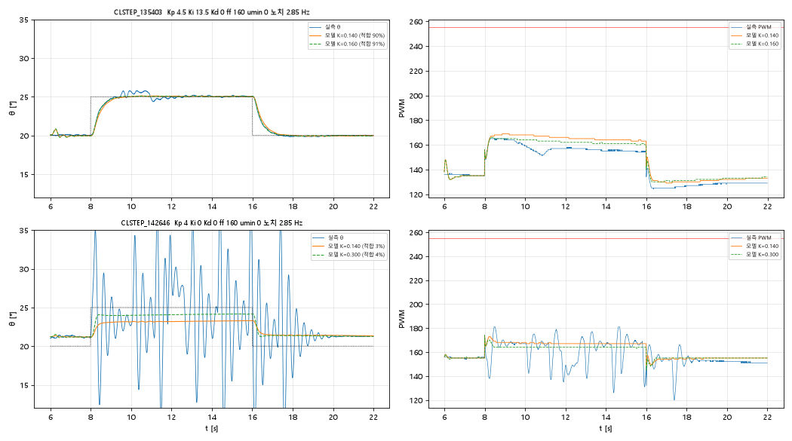

# 2026-11-13 run2 — 기구 수정 후 첫 폐루프 시험 (노치 2.85 Hz)

[run1](../../20261113_run1/analysis/REPORT.md)의 개루프 시험 직후, 같은 수정 기구에서 한 첫 하드웨어 폐루프 시험입니다(목표 4–6). 사용자가 새 공진에 맞춰 **노치를 2.85 Hz로 옮겨** 썼습니다. 이 run의 모델 검증은 run3과 같은 방법이고, 전체 결론은 [run3 보고서](../../20261113_run3/analysis/REPORT.md)에 있습니다.

| 파일 | 시험 | 제어기 (`# pid` 줄) | 조건 |
|---|---|---|---|
| CLSTEP_135403 | 폐루프 스텝 | PI Kp 4.5, Ki 13.5, ff 160, 노치 2.85 Hz (ζz 0.15, ζp 0.7) | 기준 20→25→20°, 8 / 8 / 6 s |
| CLSTEP_142646 | 폐루프 스텝 | **P** Kp 4, ff 160, 노치 2.85 Hz | 같음 |
| RELAY_142944 | 릴레이 (Z-N) | 유지용 PI Kp 4.5, Ki 19, 노치 2.85 Hz | 기준 **30°**, d = 15, 히스테리시스 0.1°, 8 s 유지 + 10 s |

공통: 펌웨어 2.1, 축 Z+, β 0.004, DLPF 5, 폐루프 최소 PWM(umin) 없음(헤더에 없음 = 0), 최대 PWM 255(기록에 255가 나옴). Downloads의 `새 폴더` 사본과 바이트가 같음을 확인했습니다.

재현: `python analysis/aero_closedloop.py data/20261113_run2 --model 0.14 0.319 0.021 2.84 0.136 0.05 6 --margin-k 0.12 0.14 0.24` (11-15 뒤 기본 모델이 바뀌어 `--model` 필요) → `closedloop.txt`, `closedloop_fit.png`, `relay_fit.png`

방법: 기준 스텝 2 s 전(6 s)의 평형(θ0, u0)에서 시작해 **최종 모델**(run1: K 0.14, T 0.319 s, L 21 ms, 2.84 Hz/ζ 0.136, 느린 경로 0.05/(6 s+1))과 **펌웨어와 같은 `pidStep`**(D 10 Hz 필터, 노치 사전왜곡 쌍선형, 최소·최대 PWM 포화, 조건부 적분)으로 시뮬레이션해 실측 θ·PWM과 겹쳐 봤습니다. 잡음·마찰·케이블은 넣지 않았습니다.

## 1. CLSTEP_135403 — PI + 노치 2.85 Hz: 잘 맞음

| | 상승(10–90%) | 오버슈트 | 정상오차 | θ 적합 | PWM 적합 |
|---|---|---|---|---|---|
| 실측 | 0.73 s | 15% | −0.04° | | |
| 모델 K = 0.14 | 0.84 s | 2.4% | −0.04° | 90.2% | 54% |
| 모델 K = 0.16 (최적) | 0.72 s | 2.1% | −0.03° | **91.3%** | 66% |
| (참고) 11-06 모델 | | | | 90.1% | 33% |

- θ는 잘 맞습니다. 상승시간도 최적 K에서 같습니다.
- 오버슈트 15%는 상승 직후가 아니라 1–3 s 뒤(9.5–11 s)의 0.7° 언덕입니다. 같은 시간에 PWM이 165 → 152로 떨어져 있어, 바깥 힘(케이블)이 각도를 밀어 올렸고 적분이 이를 되돌린 것으로 보입니다. 모델에는 없는 성분입니다.
- PWM 적합이 낮은(54–66%) 이유도 같습니다. 유지 구간 내내 실측 PWM이 모델보다 10 정도 낮습니다. 이 기록은 run3보다 1.5시간 이르고 운전점도 20–25°로 달라서, 느린 경로·평형 PWM이 run3과 조금 다른 것으로 보입니다.

## 2. CLSTEP_142646 — P 제어 Kp 4: 간헐적 큰 진동 (모델과 불일치)

- 모델은 이 제어기가 **안정**하다고 예측합니다(K 0.12–0.24에서 Ms 1.11–1.24, 이득 여유 16–22 dB). P 제어라 정상오차가 남는 것(모델 +1.7°)도 예측대로입니다.
- 실측에서는 **±10–15° 크기의 2.7 Hz 진동 덩어리가 네 번**(1.4, 7.8, 12.2, 14.1 s) 나타나고, 각각 1–1.5 s 안에 줄어듭니다. 진동 주파수는 구조 공진과 같고, 줄어드는 속도도 ζ ≈ 0.1의 자유 진동과 비슷합니다.
- 시작 부분을 확대해 보면 **PWM이 그대로이거나 줄어드는데 θ가 0.2 s 안에 15–25° 튀어 오릅니다.** 제어기가 만든 불안정이 아니라, 바깥에서 가해진 충격(케이블이 걸렸다 풀림)이 공진을 친 것으로 판단합니다. 7.8 s의 덩어리는 기준 스텝(PWM +20)과 동시에 시작했지만, 20 PWM으로는 모델상 3° 정도밖에 움직일 수 없습니다. 걸려 있던 상태가 풀리는 방아쇠가 된 것으로 보입니다.
- 같은 날 개루프 기록(run1, 10분 이상)에서는 이런 덩어리가 한 번도 없었습니다(2.2–3.6 Hz 대역 포락선 최대 0.4°). 폐루프 기록 중에서는 이 기록과 run3의 CLSTEP_152949에만 있습니다. 왜 이 두 기록에만 있는지는 데이터로 가를 수 없습니다.

## 3. RELAY_142944 — 30°에서 Ku = 6.2

| | Tu | 진폭 a | Ku = 4d/(πa) |
|---|---|---|---|
| 실측 (θ 30°, 중심 PWM 201) | **0.389 s** (2.57 Hz) | 3.06° | **6.24 PWM/°** |
| 모델 K = 0.14 | 0.369 s | 1.75° | 10.9 |
| 모델 K = 0.24 | 0.370 s | 3.00° | **6.37** |
| 모델 −180° 교차 (기술 함수 이론값) | 0.365 s | | 1.51/K |

- Tu는 모델보다 5% 깁니다(2.57 vs 2.70 Hz). 진폭이 커서(±3°) 공진이 약간 낮게 나타나거나, 운전점(30°)에서 기구가 다르게 휘는 것으로 보입니다.
- **진폭이 20° 릴레이(run3, a = 1.87°)의 1.6배**입니다. 같은 d = 15에서 진폭이 이만큼 크다는 것은 30°에서 소신호 이득이 K ≈ 0.24로 20°(K ≈ 0.15)보다 크다는 뜻입니다. 정적 특성이 PWM 200 이상에서 가팔라지는 것(run1 §2)과 같은 방향입니다. 다만 이 기록은 run3 릴레이보다 1시간 이르므로, 시간에 따른 이득 변화(전원 전압)와 완전히 분리되지는 않습니다.
- 사용자가 run3에서 쓴 Z-N 이득(Kp 6.125, Ki 33.1, Kd 0.283)은 Ku ≈ 10.2, Tu ≈ 0.37 s에 해당하므로 run3의 20° 릴레이 값으로 계산한 것으로 보입니다.

## 4. 이 run의 제어기 여유 (최종 모델)

| 제어기 | K = 0.12: Ms / PM / GM | K = 0.14 | K = 0.24 | 안정 |
|---|---|---|---|---|
| PI 4.5 / 13.5 + 노치 2.85 Hz | 1.17 / 79° / 19.5 dB | 1.20 / 78° / 18.2 dB | 1.38 / 71° / 13.5 dB | 모두 예 |
| P 4 + 노치 2.85 Hz | 1.11 / — / 22.0 dB | 1.13 / — / 20.6 dB | 1.24 / — / 15.9 dB | 모두 예 |
| (참고) 11-06 권장 PI 7.85 / 23.9 + 노치 **3.47 Hz** | 1.39 / 74° / 11.1 dB | 1.48 / 71° / 9.8 dB | 2.24 / 57° / 5.1 dB | 예 |

PM "—" = 루프 이득이 어디서도 1을 넘지 않음(P 제어, 저주파 이득 Kp·(K+Ks) < 1). 11-06 권장 이득은 노치가 옛 공진(3.47 Hz)에 맞춰져 있어, 30° 운전점(K 0.24)에서 Ms 2.2로 여유가 부족합니다. 새 모델로 다시 설계한 값은 [analysis/pid_design/REPORT.md](../../../analysis/pid_design/REPORT.md)에 있습니다.

## 5. 결론

- **PI + 2.85 Hz 노치는 의도대로 동작했고, 모델이 θ를 91% 맞춥니다.**
- P 제어 기록의 큰 진동은 모델이 예측하지 못한 **바깥 충격(케이블)에 의한 공진 울림**으로 판단합니다. 안정성 문제가 아니므로 모델을 바꿀 근거로 쓰지 않았습니다. RL 시뮬레이터에는 이런 충격을 외란으로 넣어야 합니다(run3 보고서 §6).
- 30° 릴레이에서 이득이 20°보다 약 1.6배 큽니다. 운전점(또는 시각)에 따라 K가 0.14–0.24로 달라진다는 근거입니다.
