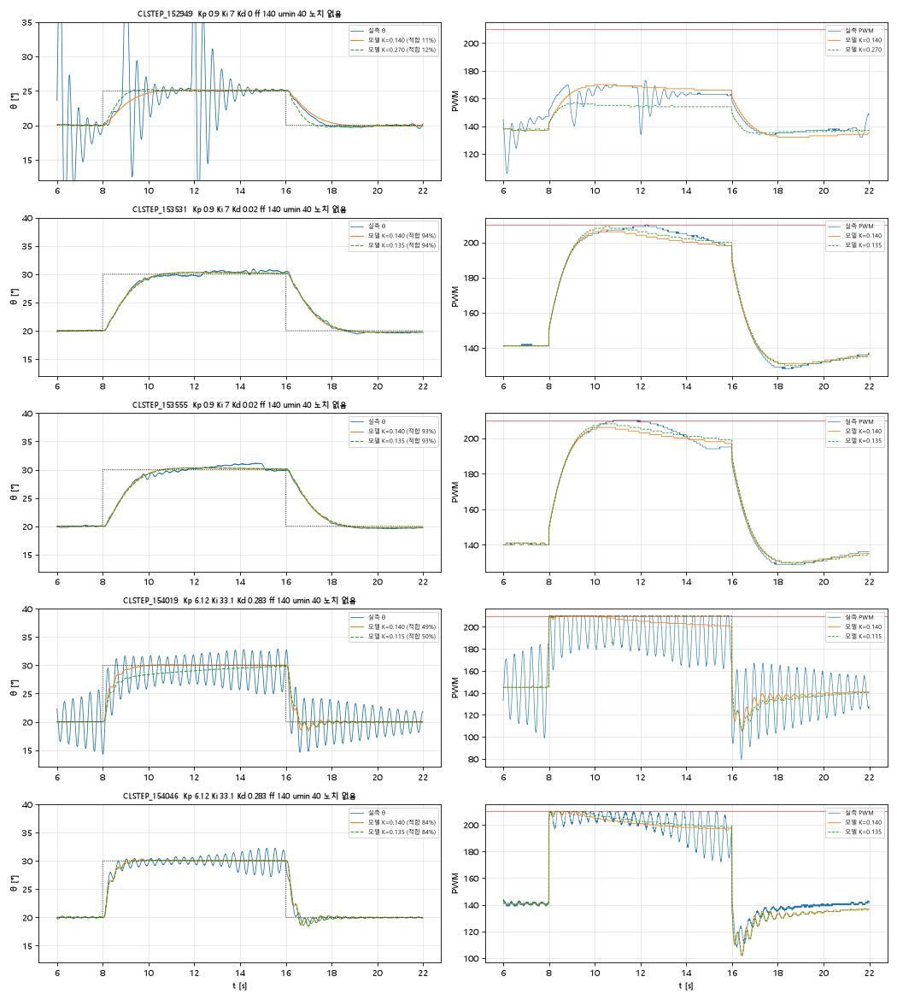
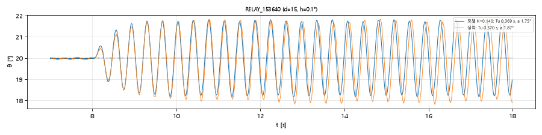

# 2026-11-13 run3 — 노치를 뺀 PID 탐색 · 새 모델의 폐루프 검증

사용자 설명: "노치를 제거하고 동작하는 PID를 찾아본" 기록입니다. 모두 [run1](../../20261113_run1/analysis/REPORT.md)과 같은 수정 기구에서 얻었습니다. 이 보고서에서 **run1의 새 모델이 폐루프 실측과 맞는지** 판정하고, RL 시뮬레이터로 쓸 때의 범위를 정리합니다.

| 파일 | 시험 | 제어기 (`# pid` 줄) | 조건 |
|---|---|---|---|
| CLSTEP_152949 | 폐루프 스텝 | PI Kp 0.9, Ki 7, ff 140, umin 40, 노치 없음 | 기준 20→25→20° |
| CLSTEP_153531, CLSTEP_153555 | 폐루프 스텝 ×2 | **손튜닝 PID** Kp 0.9, Ki 7, Kd 0.02, ff 140, umin 40, 노치 없음 | 기준 **20→30→20°** |
| RELAY_153640 | 릴레이 (Z-N) | 유지용 = 위 손튜닝 PID | 기준 20°, d = 15, 히스테리시스 0.1° |
| CLSTEP_154019, CLSTEP_154046 | 폐루프 스텝 ×2 | **Z-N PID** Kp 6.125, Ki 33.1, Kd 0.283, ff 140, umin 40, 노치 없음 | 기준 20→30→20° |
| `aeropend_settings_20261113.json` | UI 설정 | 프리셋 "PID-전달함수로부터" = 손튜닝 PID, 최대 PWM 210 | |

공통: 펌웨어 2.1, 축 Z+, β 0.004, DLPF 5, 8 / 8 / 6 s. 최대 PWM은 CSV에 없지만 기록이 210에서 잘리고 설정 파일도 210이라 **210**으로 봤습니다. 분류 근거: 153531·153555·153640은 `새 폴더 (2)` 사본과 바이트가 같고, 154019·154046은 `새 폴더 (2).zip`에 들어 있습니다. 152949는 루트에만 있지만 `# pid` 줄이 `notch_cHz=0; umin=40`이라 이 묶음입니다.

재현:
```
python analysis/aero_closedloop.py data/20261113_run3 --model 0.14 0.319 0.021 2.84 0.136 0.05 6 --margin-k 0.12 0.14 0.24   # 11-13 모델 → closedloop.txt, closedloop_fit.png, relay_fit.png (11-15 뒤 기본 모델이 바뀌어 --model 필요)
python analysis/aero_closedloop.py data/20261113_run3 --model 0.15 0.328 0.016 3.47 0.123 --margin-k 0.12 0.14 0.24 --out <임시 폴더>   # 11-06 모델 비교
python analysis/pid_design.py --model 0.14 0.319 0.021 2.84 0.136 0.05 6 --kset 0.12 0.14 0.24 --out <폴더>   # 11-13 모델 설계 (지금 기본값은 11-15 모델)
```

방법: run2와 같습니다. 스텝 2 s 전 평형에서 시작해 펌웨어와 같은 `pidStep`(최소 PWM 40, 최대 PWM 210 포함)과 모델로 시뮬레이션했습니다. 잡음·마찰·케이블은 넣지 않았습니다.

**사용한 모델 (run1 최종)**
```
G(s) = [ K/(0.319 s + 1) · ωr²/(s² + 2·0.136·ωr s + ωr²)  +  0.05/(6 s + 1) ] · e^(−0.021 s),   ωr = 2π·2.84,  K = 0.14
```

## 1. 폐루프 스텝: 실측 vs 모델



| 기록 | 실측 상승 / 오버슈트 / 정상오차 | 모델 (K = 0.14) | θ 적합 | PWM 적합 | 최적 K | 11-06 모델 θ / PWM 적합 |
|---|---|---|---|---|---|---|
| 153531 손튜닝 PID | 1.51 s / 7.9% / −0.48° | 1.59 s / 3.3% / −0.18° | **94.3%** | **92.6%** | 0.135 | 92.8% / 78.8% |
| 153555 손튜닝 PID | 1.45 s / 11.1% / −0.48° | 1.59 s / 3.2% / −0.18° | **92.8%** | **91.9%** | 0.135 | 91.3% / 76.1% |
| 154046 Z-N PID | 0.50 s / 18% / +0.10°, 30°에서 진동 (σ 1.4°) | 0.73 s / 2.3% / −0.03° | **84.1%** | **79.8%** | 0.135 | 84.3% / 74.7% |
| 154019 Z-N PID | 0.44 s / 23% / +1.11°, 20°·30° 모두 진동 (σ 2.6–3.2°) | 안정(감쇠 느림) | 49.5% | 43.9% | — | 49.3% / 36.6% |
| 152949 PI (Kd 0) | 바깥 충격 4회 (아래 §4) | 1.58 s / 3.5% | 10.9% | 48.8% | — | 11.0% / 42.6% |

비교 기준: 개루프 반복 기록으로 계산한 잡음 한계 적합도는 CHIRP 70%, STEP 83%입니다(run1). 폐루프 θ는 기준을 따라가므로 신호가 커서 이보다 높게 나옵니다.

- **손튜닝 PID 두 기록에서 θ 93–94%, PWM 92–93%로 맞습니다.** 측정 잡음과 반복 차이 수준입니다. 상승시간 차이는 5–10%입니다.
- 남는 차이는 유지 구간 끝의 0.3–0.5° 넘침(실측 −0.48°, 모델 −0.18°)과, 기준을 내린 뒤 PWM이 129까지 내려갔다 올라오는 깊이입니다. 느린 경로가 실제로는 모델보다 조금 크거나 방향에 따라 다릅니다(히스테리시스).
- **최적 K가 세 기록 모두 0.135로 같습니다**(K만 바꿔 가며 θ 적합 최대). 20–30° 구간의 빠른 이득이 run1 CHIRP(0.13–0.145)과 일치합니다.
- **11-06 모델도 θ는 거의 같게 맞습니다(91–93%).** 손튜닝 PID는 대역이 낮아(약 0.3 Hz) 공진 근처를 거의 쓰지 않기 때문입니다. 두 모델을 가르는 것은 PWM 궤적(새 모델 92–93% vs 76–79%)과 릴레이(§2)입니다.
- 손튜닝 PID 기록에서 유지 구간 동안 PWM이 210에 닿습니다(153531 0.1 s, 153555 1.1 s 포화). 모델도 같은 시점에 210에 닿습니다.

## 2. 릴레이 → Ku, Tu



| | Tu | 진폭 a | Ku = 4d/(πa) |
|---|---|---|---|
| **실측** RELAY_153640 (20°, 중심 PWM 144) | **0.370 s** (2.70 Hz) | 1.87° | **10.23 PWM/°** |
| 새 모델 K = 0.14 | 0.369 s | 1.75° | 10.92 |
| 새 모델 K = 0.17 | 0.369 s | 2.12° | 8.99 |
| 11-06 모델 K = 0.15 | **0.300 s** (3.33 Hz) | 1.62° | 11.82 |
| `lab/sim.js` (새 플랜트, 브라우저 시뮬레이터) | 0.368 s | 1.62° | 11.84 |
| (run2) 실측 RELAY_142944 (30°) | 0.389 s | 3.06° | 6.24 |

- **Tu가 새 모델과 0.3% 안에서 같습니다.** 11-06 모델은 Tu를 19% 짧게 예측합니다. 실측 진폭은 K ≈ 0.15에 해당합니다(새 모델 K 0.14와 7% 차이).
- Z-N 이득을 실측으로 계산하면 Kp 6.14, Ki 33.2, Kd 0.284로, 사용자가 154019·154046에 쓴 값과 같습니다.

## 3. Z-N PID가 30°에서 진동하는 이유 — 모델로 설명됨

| 제어기 | K = 0.12: Ms / PM / GM | K = 0.14 (20°) | K = 0.24 (30°) |
|---|---|---|---|
| Z-N PID 6.125 / 33.1 / 0.283 | 2.53 / 69° / 4.5 dB | **3.37** / 69° / 3.1 dB | **5.36 / 71° / −1.6 dB → 불안정** |

- 모델에서 Z-N PID는 20°(K 0.14)에서 **안정이지만 여유가 매우 작고**(Ms 3.4, 이득 여유 3 dB), 30°의 이득(K 0.24, run2 릴레이)에서는 **불안정**합니다.
- 실측도 그렇습니다. 154046은 20°에서는 가라앉았다가 30°에서 진동(σ 1.4°)이 계속됐고, 154019는 20°에서도 진동했습니다(σ 3.2°, 30°에서 2.6°). 진동 주파수는 2.6–2.7 Hz(공진)이고, 30°에서는 PWM이 210 포화와 140 사이를 오가며 진폭이 제한됩니다.
- 선형 모델은 포화로 제한되는 지속 진동(리밋 사이클)을 K 0.14에서는 재현하지 못합니다(154019 적합 50%). 모델이 경계 근처(Ms 3.4)에 있어서 K가 10–20%만 커져도 불안정해지므로, 같은 이득으로 한 번은 가라앉고 한 번은 진동한 것이 모델의 예측과 모순되지 않습니다.
- 결론: **Z-N의 Ku·Tu가 진자가 아니라 2.84 Hz 구조 공진에서 정해져 이득이 공격적으로 나온다**는 11-06의 판단이 수정 기구에서도 실측으로 확인됐습니다.
- PM이 69–71°로 커 보이는데도 불안정한 이유: 첫 교차(저주파)의 위상 여유는 크지만, 공진 근처에서 루프 이득이 다시 1에 가까워집니다. 이 플랜트에서는 PM보다 **Ms**를 봐야 합니다.

## 4. 바깥 충격 (CLSTEP_152949, run2 CLSTEP_142646)

- 152949는 θ가 **0.2 s 안에 15–25° 튀었다가** 2.6 Hz로 1–1.5 s 울리는 일이 네 번(2.9, 5.5, 8.6, 11.5 s) 있습니다. 시작 순간 PWM은 그대로이거나 줄어들고 있었으므로 **제어기가 만든 것이 아니라 바깥 힘**입니다. θ<sub>acc</sub>도 같이 움직여 센서 문제도 아닙니다.
- 이 제어기는 모델에서 Ms 1.11–1.18, 이득 여유 17–23 dB로 매우 안정합니다. 울림이 줄어드는 속도도 공진의 자유 진동(ζ ≈ 0.1–0.14)과 같습니다.
- 케이블이 걸렸다가 풀리는 것으로 추정합니다(사용자: 케이블 간섭이 아직 꽤 남아 있음). 손튜닝 PID와의 차이는 Kd 0.02뿐인데, 그 두 기록에는 충격이 없습니다. Kd 0.02는 공진에서 감쇠를 거의 더하지 못하므로(2.84 Hz에서 0.36 PWM/° 수준) 우연일 가능성이 높습니다.
- 크기: 충격 직후 각속도 최대 260–340 °/s, 각도 변화 15–25°. 7개 폐루프 기록 중 2개에서, 기록당 4회(약 0.2회/s) 발생했습니다.

## 5. 손튜닝 PID (프리셋 "PID-전달함수로부터")의 여유

| K (빠른 경로) | Ms | 위상 여유 | 이득 여유 | 비고 |
|---|---|---|---|---|
| 0.12 | 1.11 | 75.0° | 22.1 dB | |
| **0.14 (20°)** | **1.12** | **74.5°** | **20.8 dB** | 공칭 |
| 0.24 (30°) | 1.19 | 70.2° | 16.1 dB | |
| 9개 조합 최악 (K 0.12–0.24 × 공진 ±10%, `pid_design.py`) | 1.21 | 70.0° | 15.3 dB | |

- **매우 강인하지만 느립니다**(상승 1.5 s). Ms 1.6까지 허용하면 같은 구조로도 더 빠르게 할 수 있습니다. 새 모델로 다시 설계한 값(`analysis/pid_design/summary.txt`): PI + 2.84 Hz 노치 Kp 5.40, Ki 16.9 (상승 0.63 s, 최악 Ms 1.6), 노치 없는 PI Kp 2.10, Ki 6.58 (상승 2.1 s). **하드웨어에서 아직 시험하지 않았습니다.**
- 노치 없이는 공진 때문에 Kp를 약 2 이상으로 올리기 어렵습니다. 사용자가 고른 Kp 0.9 / Ki 7(Ti = 0.13 s)은 비례 이득을 낮추고 적분으로 추종하는 방식이라 공진을 거의 건드리지 않습니다.

## 6. 판정 · RL 시뮬레이터로 쓸 때

**판정: 새 모델은 폐루프 실측과 잡음·반복 차이 수준으로 맞습니다.** 손튜닝 PID θ·PWM 92–94%, 20° 릴레이 Tu 0.3%·Ku 7% 차이, Z-N 진동의 발생 조건도 설명됩니다. 그래서 `analysis/pid_design.py`, `lab/sim.js`, `lab/sysid.js`, `matlab/aero_pid_design.m`의 플랜트 상수를 이 모델로 바꿨습니다(11-06 값은 주석에 "기구 수정 전"으로 남김).

모델이 **못 하는 것**:
1. 케이블 충격(§4)과 그 뒤 공진 울림.
2. 운전점에 따른 이득 변화(20°에서 K 0.15, 30°에서 0.24). 상수 모델은 K 하나입니다. `sim.js`는 정적 지도의 기울기로 일부 반영합니다.
3. 히스테리시스·마찰. 같은 20°를 유지하는 PWM이 129–145로 기록마다 다르고, 계단 두 번이 3° 차이 납니다.
4. 큰 신호(정지 상태에서 출발, PWM > 200)는 정적 지도에 의존하고, 검증은 20–30° 소신호 위주입니다.

**도메인 랜덤화 제안** (에피소드마다 뽑기)

| 파라미터 | 공칭 | 범위 | 근거 |
|---|---|---|---|
| 빠른 이득 K [°/PWM] | 0.14 | **0.11–0.26** (로그 균등) | CHIRP 0.13–0.145, 폐루프 최적 0.135, 릴레이 20° 0.15 / 30° 0.24, 11-06 세션 중 −20% 변동 |
| 느린 이득 Ks | 0.05 | 0–0.08 | 정적 기울기 0.20–0.22 − K, 폐루프 PWM 궤적 |
| 느린 시정수 Tc | 6 s | 3–10 s | 폐루프 격자 탐색에서 3–8 s가 비슷하게 맞음 |
| 시정수 T | 0.319 s | 0.27–0.38 s | 느린 경로 유무에 따라 0.30–0.32, 11-06 0.328 |
| 지연 L | 21 ms | 15–30 ms | DLPF 4 → 16 ms, DLPF 5 → 21 ms, + 샘플 위상 |
| 공진 fr | 2.84 Hz | 2.5–3.1 Hz | 30° 릴레이 2.57 Hz, 기구 변경 가능성 |
| 공진 ζr | 0.136 | 0.09–0.18 | 맞춤 0.136–0.142 |
| 정적 지도 오프셋 | 0 | ±3° (또는 ±15 PWM) | 계단 두 번 3.2° 차이, 20° 평형 PWM 129–145 |
| 충격 외란 | — | 0–0.2회/s, 각속도 충격 100–300 °/s | §4 (7개 기록 중 2개) |
| 측정 잡음 | θ σ 0.04° | 0.02–0.08° | 유지 구간 σ 0.03–0.06° |
| 출력 제약 | umin 40, umax 210 | 그대로 | 펌웨어 설정 |

- 상수 K 대신 운전점 의존 K(θ)를 쓰려면 20°에서 0.15, 30°에서 0.24 사이를 선형 보간하는 것을 출발점으로 권합니다. 25°에서 직접 잰 값은 없습니다.
- 학습한 정책의 첫 하드웨어 시험은 20–30° 범위, 최대 PWM 210, 각도 한계를 낮게 두고 하세요(AGENTS.md 안전 규칙: 모터 구동 명령은 사람이 그 자리에서 허락한 뒤).

## 7. 확인하지 못한 것

- 하드웨어에서 새 설계 이득(PI + 2.84 Hz 노치 등)은 실행하지 않았습니다. 이 세션은 시리얼 포트를 열지 않았습니다.
- 25°에서의 소신호 이득, 30°에서 이득이 큰 것이 운전점 때문인지 시각(전원 전압) 때문인지.
- 모터 전원 전압(기록 없음).
- MATLAB(`aero_pid_design.m`)은 상수만 고쳤고 실행하지 않았습니다(실행 환경 없음).
