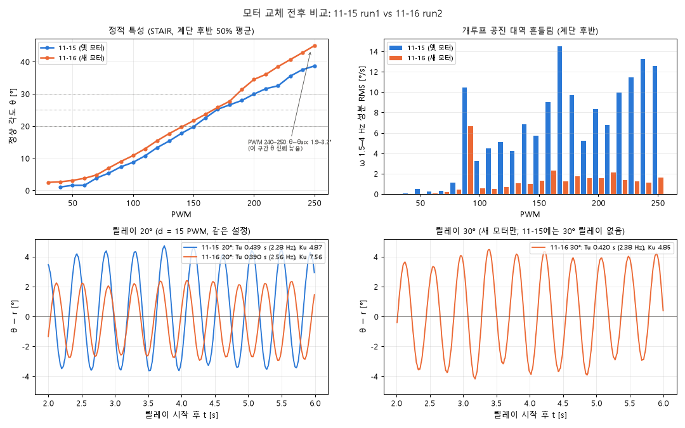

# 2026-11-16 run2 — 모터 교체 후 재식별 (vs 11-15 run1)

모터를 바꾼 뒤 11-15 run1과 같은 구성으로 개루프 시험(STAIR, CHIRP, STEP, 릴레이)을 다시 했습니다. 동작점은 새 모터 기준으로 옮겼습니다(20° ≈ PWM 141, 30° ≈ 186).

**결론**
- **공진**: 2.35 Hz / ζ 0.084에서 **2.57 Hz / ζ 0.150**으로 바뀌었습니다. 올라가고 감쇠도 두 배 가까이 커졌습니다.
- **한계 이득**: 20°에서 릴레이 Ku가 4.87 → **7.56**, 모델로는 8.8입니다.
- **이득**: 빠른 경로 K가 0.164 → **0.192**입니다. 느린 경로는 Ks 0.12 / Tc 3 s에서 **0.06 / 5 s**로 작아졌습니다.
- **추력**: PWM 180까지는 옛 모터와 거의 같고, 190 위에서는 훨씬 셉니다(250에서 44.9° vs 38.6°).
- **데이터 품질**: 11-15보다 크게 좋아졌습니다. θ<sub>acc</sub> σ가 10–14°에서 4–6°로 줄었고, CHIRP 쌍 SNR은 4.3에서 18입니다. 계단 유지 중 공진 대역(1.5–4 Hz) 흔들림도 약 1/5로 줄었습니다. 옛 모터가 공진을 세게 가진하고 있었던 것으로 보입니다.
- **PID**: 새 모델로 다시 설계한 PI + 노치는 Kp 4.36 / Ki 12.2로, 지금 값 4.30 / 13.3과 거의 같습니다. 노치를 2.35, 2.45, 2.57 Hz 어디에 두어도 최악 Ms 차이는 0.02 이하입니다(감쇠가 커서). **PID는 그대로 둡니다.**



## 파일

| 파일 | 시험 | 조건 |
|---|---|---|
| STAIR_213908 | 정적 특성 | PWM 30→255, 10씩, 계단 8 s |
| RELAY_214233 / 214303 | 릴레이 20° / 30° | d = 15 PWM, 히스테리시스 0.1°, pre 8 s / 10 s |
| CHIRP_220446, CHIRP_220623 | 스윕 ×2 (20°) | PWM 140 ± 12, 0.1→8 Hz 로그, 60 s |
| CHIRP_221133 | 스윕 (30°) | PWM 186 ± 12, 같은 스윕 |
| STEP_220838, STEP_220954 | 스텝 ×2 | PWM 140→152→140, pre 12 s / 10 s / 10 s |
| STEP_221455 | 긴 스텝 (느린 경로) | 같은 스텝, 30 s / 30 s |

공통 조건:
- 펌웨어 AEROPEND_LAB 2.1, 축 Z+, β 0.01, DLPF 5, Ts 10 ms.
- 릴레이 앞 구간(pre)의 PID는 4.34 / 13.4 / 0.067(노치 없음)입니다. 릴레이 구간에는 영향이 없습니다.

재현:
```
python analysis/aero_analyze.py data/20261116_run2 --angle theta
python analysis/aero_model_fit.py --est data/20261116_run2/aero_CHIRP_20261116_220446.csv data/20261116_run2/aero_CHIRP_20261116_220623.csv --val data/20261116_run2/aero_CHIRP_*.csv "data/20261116_run2/aero_STEP_*.csv"
python analysis/aero_model_fit.py --est (위와 같음) --model 0.1924 0.357 0.023 2.57 0.150 0.06 5 --val (위와 같음)
python analysis/aero_closedloop.py data/20261116_run2 --model 0.1924 0.357 0.023 2.57 0.150 0.06 5 --margin-k 0.15 0.192 0.30
python analysis/pid_design.py --model 0.1924 0.357 0.023 2.57 0.150 0.06 5 --kset 0.15 0.192 0.30 --out data/20261116_run2/analysis/pid_design
python data/20261116_run2/analysis/compare_1115.py
```

## 1. 품질

| 지표 | 11-15 run1 | **11-16 run2** |
|---|---|---|
| θ<sub>acc</sub> σ (20° CHIRP·STEP) | 10.5–14.3° | **4.0–5.6°** (30° CHIRP는 15°) |
| CHIRP 반복 쌍 | 상관 0.804, SNR 4.3, 잡음 한계 적합도 ≈57% | 상관 **0.957**, SNR **18**, ≈**77%** |
| STEP 반복 쌍 | 상관 0.946, SNR 15.5, ≈75% | 상관 **0.990**, SNR **78**, ≈**89%** |

각도는 Madgwick θ를 씁니다(`--angle theta`). STAIR의 PWM 240–250 구간은 θ − θ<sub>acc</sub>가 1.9–3.2°라 믿기 어렵습니다(RL 상한 230이라 쓰지 않음).

## 2. 정적 특성

| PWM | 100 | 130 | 140 | 150 | 170 | 190 | 200 | 220 | 250 |
|---|---|---|---|---|---|---|---|---|---|
| 11-15 θ [°] | 8.7 | 15.4 | 17.7 | 19.8 | 25.2 | 27.9 | 29.9 | 32.5 | 38.6 |
| **11-16 θ [°]** | 10.8 | 17.7 | 19.7 | 21.7 | 25.8 | 31.3 | 34.5 | 38.5 | 44.9 |

- **정지 위치**: 2.5–2.7°이고, 11-15는 PWM 40에서 1.1°였습니다. PWM 100–150의 약 2° 차이는 대부분 이 정지 위치 차이입니다.
- **평형 PWM**: 20° ≈ 141(옛 약 150), 25° ≈ 166, 30° ≈ 186(옛 약 200).
- **국소 기울기**: PWM 130–170은 0.202, 160–200은 0.271 °/PWM입니다. 운전점에 따른 이득 차이가 옛 모터(0.245 / 0.175)보다 큽니다.

## 3. 동적 모델

```
11-16: P(s) = [ 0.192/(0.357 s + 1) · 16.1²/(s² + 4.84 s + 16.1²)  +  0.06/(5 s + 1) ] · e^(−0.023 s)    [deg/PWM]
11-15: P(s) = [ 0.164/(0.324 s + 1) · 14.8²/(s² + 2.48 s + 14.8²)  +  0.12/(3 s + 1) ] · e^(−0.024 s)
```

| | K | T | L | 공진 | ζ | 주파수응답 오차 | P 한계 이득 |
|---|---|---|---|---|---|---|---|
| 11-15 (20°) | 0.164 | 0.324 s | 24 ms | 2.35 Hz | 0.084 | 14% | 5.0 |
| **11-16 (20°, CHIRP 2회)** | **0.192** | 0.357 s | 23 ms | **2.57 Hz** | **0.150** | 7% | **8.8** |
| 11-16 (30°, CHIRP 1회, 참고) | 0.215 | 0.369 s | 18 ms | 2.49 Hz | 0.123 | 30% | 6.6 |

시간영역 검증(느린 경로 포함):

| 기록 | CHIRP ×2 (추정) | CHIRP 30° | STEP ×2 | 긴 STEP |
|---|---|---|---|---|
| 적합도 | 78.0 / 79.9% | 30.5% | 80.9 / 74.1% | 81.2% |

- 20° 기록은 잡음 한계(CHIRP 약 77%, STEP 약 89%)에 가깝습니다.
- **느린 경로 Ks 0.06 / Tc 5 s**는 Ks 0–0.16 × Tc 2–8 s 격자에서 STEP 세 개와 CHIRP를 함께 가장 잘 맞춘 값입니다. 11-15 값(0.12 / 3 s)으로는 STEP 적합도가 55–61%로 떨어집니다.
- 30° CHIRP는 잡음(θ<sub>acc</sub> σ 15°)과 적합도 모두 나빠 참고용입니다(11-15도 같은 상황).

**릴레이 검증** (`closedloop.txt`, `relay_fit.png`)

| | 실측 | 모델 (K 0.192) |
|---|---|---|
| 20°: Tu / Ku | 0.390 s / 7.56 | 0.409 s / 8.74 |
| 30°: Tu / Ku | 0.420 s / 4.85 | (K 0.24에서 7.0) |

- 20°는 모델이 Ku를 16% 낙관합니다. 등가 K로 치면 약 0.22입니다.
- 30° 릴레이는 PWM 173–203을 오가며 정적 지도가 가파른 구간(180→190에서 3.6°)을 지납니다. 그래서 등가 이득이 훨씬 큽니다(약 0.3 이상). 강인성 평가 K를 0.15 / 0.192 / 0.30으로 잡은 이유입니다.

## 4. PID (`pid_design/`)

| 설계 (새 모델) | Kp | Ki | Kd | 최악 Ms | tr | 비고 |
|---|---|---|---|---|---|---|
| PI + 노치 2.57 Hz (Ms ≤ 1.6) | 4.36 | 12.2 | 0 | 1.60 | 0.60 s | 현재 값과 거의 같음 |
| PID + 노치 (Td = 0.05 Ti) | 4.76 | 13.3 | 0.085 | 1.60 | 0.55 s | |
| 손튜닝 PID | 0.9 | 7 | 0.02 | 1.24 | 1.14 s | |
| Z-N PID (노치 없음) | 5.24 | 25.9 | 0.265 | 불안정 | | 노치 있으면 1.73 |

**현재 PI + 노치(4.30 / 13.3)의 노치 위치별 최악 Ms** (K 0.15–0.30, 공진 2.31–2.83 Hz):

| 노치 | 2.35 Hz | 2.45 Hz | 2.57 Hz |
|---|---|---|---|
| 최악 Ms | 1.57 | 1.59 | 1.61 |

감쇠가 커져서 노치 위치는 거의 상관없습니다. **PID와 노치(2.35 Hz)는 그대로 두고, 새 RL의 기준선·복귀 PID로 이 PI + 노치를 씁니다**(`rl/configs/motor2.json`).

## 5. 같은 날 시연 기록

`data/20261116_run1`(15:08–15:12, 시연 펌웨어 PID 유지)은 20°에 PWM 155–159가 들었고, 25°에서는 PWM 254로 포화됐습니다. 새 모터의 20° 평형(141)과 맞지 않으니, 교체 전 옛 모터의 추력이 떨어지던 때의 기록으로 보입니다.
